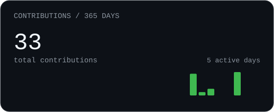
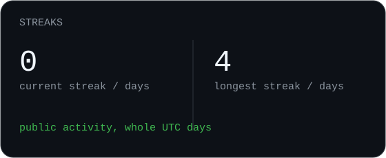
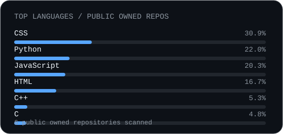
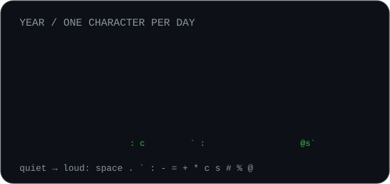

<!-- Profile Header -->

  <h1>Hi, I'm Batuhan Çakmak 👋</h1>

I'm interested in building practical systems around **cybersecurity, computer networks, Raspberry Pi, IoT and software development**. I enjoy learning by creating projects that combine software with real hardware and network infrastructure.

- 🎓 Computer Engineering student at Kadir Has University
- 🛡️ Interested in Cybersecurity and Network Engineering
- 🥧 Working with Raspberry Pi and Linux-based systems
- 🔌 Building IoT and embedded-style projects
- 💡 Learning Python, web technologies and networking
 

### 🛠️ Tech Stack & Skills

<table align="center">
  <tr>
    <td align="center" width="33%">
      <b>Languages</b>  
      
      
      
      
      
      
    </td>
    <td align="center" width="33%">
      <b>Systems & Tools</b>  
      
      
      
      
      
      
    </td>
    <td align="center" width="33%">
      <b>Networking & Security</b>  
      
      
      
      
      
      
      
    </td>
  </tr>
</table>

## 🎯 Areas of Interest & Currently Learning

* 🔒 **Cybersecurity & Network Security**
* 🐧 **Linux Systems Administration & Infrastructure**
* 🥧 **Raspberry Pi & IoT Projects**
* 🐍 **C/C++, Python & Backend Development**

<!-- GENERATED_STATS_START -->

  
  

  
  

<!-- GENERATED_STATS_END -->

