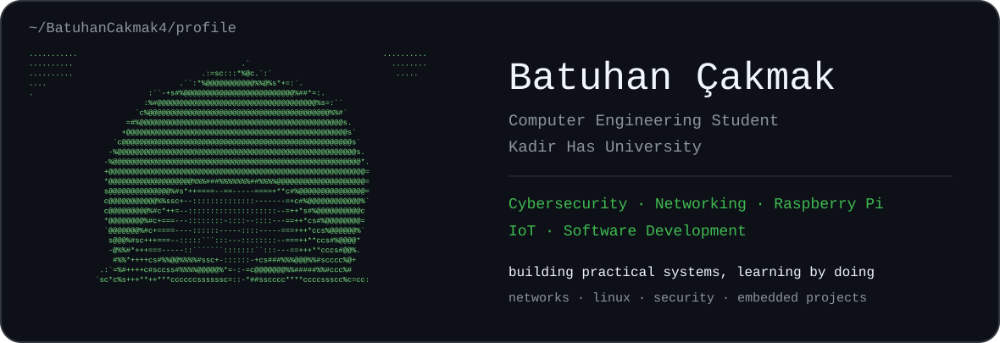
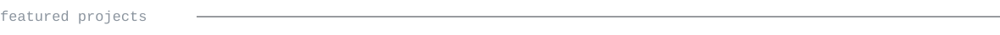
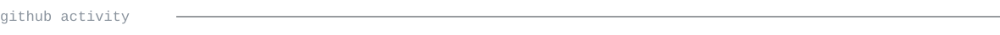

  

> Computer Engineering student at Kadir Has University, focused on cybersecurity, networking, Raspberry Pi, IoT and practical software projects.

**[physical-raspberryPi-network-lab](https://github.com/BatuhanCakmak4/physical-raspberryPi-network-lab)**  
Physical enterprise-style network lab with an Aruba 2930F Layer 3 switch, Raspberry Pi infrastructure servers, VLAN segmentation, routing, DHCP, DNS, Nginx, real-client testing, and a roadmap toward firewalling, monitoring, VPN and IDS/IPS.

**smart mirror**  
Raspberry Pi smart-mirror project for a 24-inch display with dynamic greetings, weather, Spotify, calendar integration, indoor sensors, presence detection and LED backlighting.

**enterprise network lab / Packet Tracer**  
A simulated enterprise-networking project used to practice VLANs, routing, DHCP, DNS, management access, ACLs and troubleshooting.

<samp>cybersecurity · computer networks · linux · raspberry pi · iot · python · web technologies</samp>

<!-- GENERATED_STATS_START -->
<!-- GENERATED_STATS_END -->

Every graphic in this profile is stored in this repository. The portrait is generated from a photo as ASCII, and the activity graphics are generated from the GitHub GraphQL API by a scheduled GitHub Action.

The profile avoids third-party README stats services, so the generated graphics remain under the repository owner's control.

Portrait approach inspired by the ASCII Portrait README Guide. Visual language inspired by the self-generating profile approach documented by andriidrok1. Preferred typeface: JetBrains Mono (SIL OFL 1.1); this repository does not bundle font binaries.
